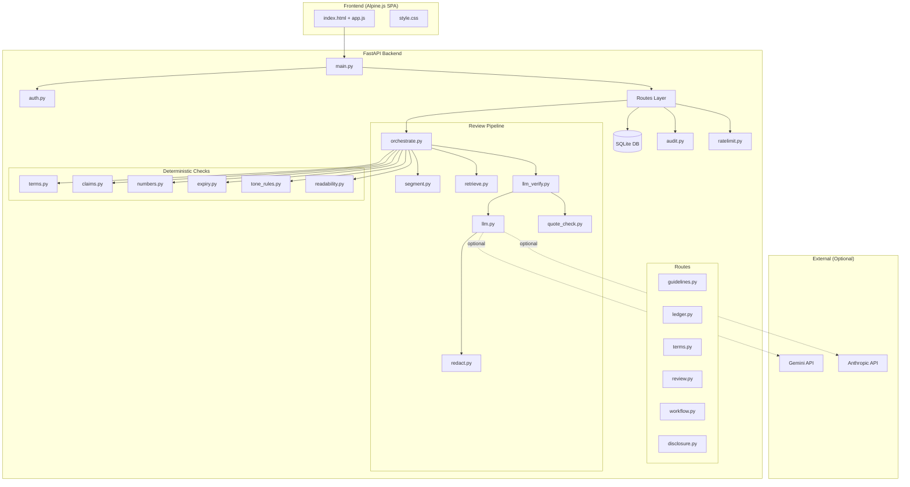
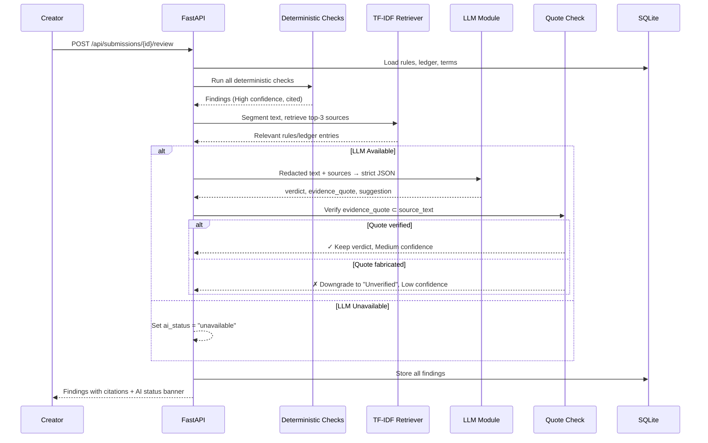

# BrandProof – Architecture

## Component Diagram

## Data Flow: Cite-or-Abstain Pipeline

## Key Technical Decisions

### 1. TF-IDF over FAISS/Embeddings
**Why**: With only 14 rules and 10 ledger entries, TF-IDF provides excellent retrieval quality without requiring GPU, torch, or heavy dependencies. Keeps memory under 400MB and installation simple.

### 2. SQLite over PostgreSQL
**Why**: Single-file database with zero configuration. Perfect for a hackathon demo. SQLAlchemy abstraction means switching to PostgreSQL later requires only changing the connection string.

### 3. Deterministic Checks First
**Why**: Rule-based checks are fast, free, 100% reliable, and produce High confidence findings. They handle the most critical violations (banned terms, number mismatches, expired claims) without any AI. The LLM is only used for ambiguous cases that code can't fully resolve.

### 4. Quote Verification (Cite or Abstain)
**Why**: LLMs hallucinate. When the AI cites evidence, we verify the quote is a literal substring of the source text. If not, the finding is downgraded to "Unverified" with low confidence. This is the core trust mechanism.

### 5. itsdangerous over PyJWT
**Why**: Simpler API for signed tokens in a demo context. No need for JWT claims structure. Token includes user_id, role, and name.

### 6. Alpine.js over React/Vue
**Why**: No build step required. The entire frontend is served as static files by FastAPI. Alpine.js provides reactive data binding with minimal overhead. The judge can inspect the code without any Node.js tooling.

### 7. Provider-Agnostic LLM Module
**Why**: Using plain httpx calls instead of SDKs (google-generativeai, anthropic) keeps dependencies light and allows switching providers via environment variables. The cache layer ensures demo functionality even without API keys.

### 8. Redaction Before LLM
**Why**: Privacy by design. Emails, phone numbers, and configurable terms are masked before any text leaves the server. The LLM never sees raw PII.

### 9. In-Memory Rate Limiter
**Why**: Simple per-IP token bucket. Sufficient for a demo deployment. In production, would use Redis or a distributed rate limiter.

### 10. Role-Based Access Control
**Why**: Every route is guarded server-side. The frontend shows/hides UI elements based on role, but the backend enforces permissions independently. Creator can't approve, reviewer can't create submissions.
